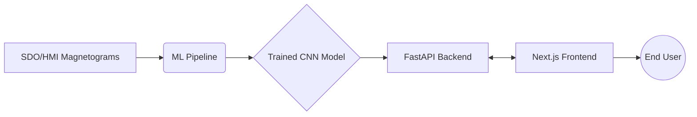
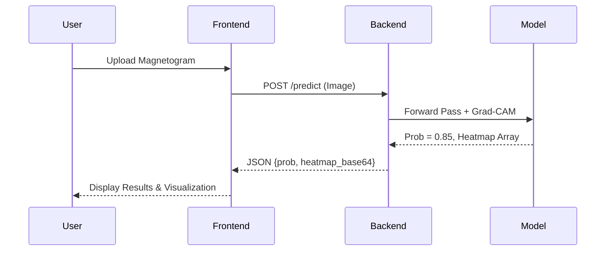

# System Architecture

## Overall System Architecture

The SolarCast system is divided into three main components:
1. **ML Pipeline**: Handles data preprocessing, model training, and evaluation.
2. **Backend API**: A FastAPI server that exposes the trained model for inference.
3. **Frontend Application**: A Next.js web application for user interaction and visualization.

## ML Pipeline Architecture
The pipeline consists of modular scripts:
- **Data Generator**: Creates synthetic data for testing.
- **Preprocessor**: Cleans, resizes, and normalizes FITS/NumPy arrays into ML-ready tensors.
- **Trainer**: Manages PyTorch training loops, loss calculation, and model checkpointing.
- **Evaluator**: Calculates TSS, HSS, and generates PR/ROC curves.

## SolarCNN Architecture
SolarCNN is a custom Convolutional Neural Network designed for spatial feature extraction from magnetograms.

**Layer-by-Layer Description:**
1. **Input Layer**: 1x224x224 (grayscale magnetogram).
2. **Initial Conv Layer**: 7x7 Convolution, Stride 2, Batch Norm, ReLU, followed by Max Pooling.
3. **Residual Block 1**: 2x (3x3 Conv, Batch Norm, ReLU), skip connection.
4. **Residual Block 2**: Downsample (stride 2), 2x (3x3 Conv, Batch Norm, ReLU), skip connection.
5. **Residual Block 3**: Downsample (stride 2), 2x (3x3 Conv, Batch Norm, ReLU), skip connection.
6. **Global Average Pooling**: Reduces spatial dimensions to a 1D vector.
7. **Fully Connected Layer**: Linear layer mapping to 1 output unit.
8. **Output**: Sigmoid activation (Probability of M/X flare).

### Residual Block Design
Residual blocks use identity skip connections. If the input is $x$, the block computes $F(x) + x$, where $F(x)$ represents the convolutional layers. This mitigates the vanishing gradient problem, allowing the network to learn deeper representations of complex magnetic structures like delta configurations.

## Inference Pipeline
1. The backend receives an image or data array.
2. Preprocessing applies identical normalization and resizing as training.
3. The tensor is passed through the PyTorch (or ONNX) model.
4. Grad-CAM is calculated on the last convolutional layer.
5. The probability and base64-encoded Grad-CAM heatmap are returned.

## Backend API Architecture
- Framework: **FastAPI** (Python).
- Endpoints:
  - `GET /health`: System status.
  - `POST /predict`: Accepts image/array upload, returns flare probability and Grad-CAM overlay.
- Server: Uvicorn ASGI server.

## Frontend Architecture
- Framework: **Next.js** (React).
- Styling: Tailwind CSS.
- Features: Image upload component, probability display (gauge/progress bar), side-by-side view of original magnetogram and Grad-CAM heatmap.

## Data Flow

## Model Size and Computational Requirements
- **Parameters**: ~2-5 Million.
- **Disk Size**: ~10-20 MB (.pth or .onnx).
- **Compute (Training)**: Single standard GPU (e.g., NVIDIA T4, RTX 3060) is sufficient; training takes ~1-3 hours depending on dataset size.
- **Compute (Inference)**: CPU inference is fast (< 100ms per image), making it suitable for lightweight cloud deployment without GPU instances.
